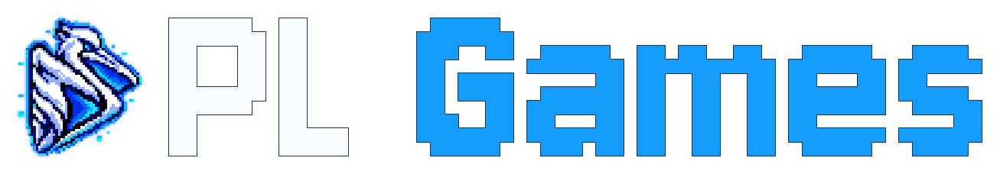
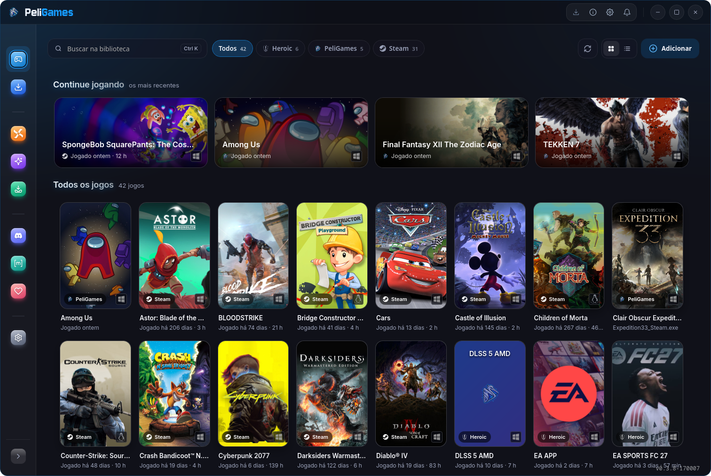

<p align="center">
  
</p>

> **0.4.6 experimental:** MAKO frame generation and the new PeliGames in-game overlay are available for testing, with per-game opt-in. Mouse capture, focus, shortcuts and compatibility with some games/Proton versions may still have issues. See the [usage and limitations guide](docs/overlay.md).

<p align="center"><a href="README.md">Português</a> · <strong>English</strong></p>

Windows game launcher for Linux with Proton, a game library, Pelinstall, Wine tools, Nexus Mods integration and the DLSSNR-AMD mod manager.

<p align="center">
  
</p>

## How it works

1. **Library:** PeliGames brings together games from Steam, the native Epic Games Launcher for Linux, Heroic, Lutris, Bottles and Faugus, plus the ones you install with it.
2. **Installing Windows games and programs:** pick the installer (`.exe` or `.msi`), a name, a folder and a Proton version. PeliGames prepares the prefix, runs the installer and finds the game's executable by itself. When several executables are possible, it asks.
3. **Launchers (EA app, Battle.net, Ubisoft Connect, Epic):** games installed from inside a launcher appear under **Programs**, ready to open directly. When one of them is added to the library, it gets a profile of its own (separate prefix, Proton and mods) without duplicating the launcher's files.
4. **Nexus Mods:** in **Mods → Nexus Mods**, add the game, pick mods from the catalog (or import an archive) and click **Install**. PeliGames checks the requirements, runs the FOMOD installer when there is one and deploys the files following the game's rules, the same ones the Vortex game extensions use. Enabling, disabling and removing mods never changes the game's original files. See the [supported games](docs/supported-games.md).
5. **Problems:** **Report error** builds a report for the game and can send it straight to the PeliGames support forum on Discord. Launcher errors also show up in the notification bell.

## Installation

Download the AppImage, RPM or DEB from [Releases](https://github.com/pelicanux/PeliGames/releases).

- RPM and DEB install the `peligames` and `pelinstall` binaries in `/opt/PeliGames`, with commands in `/usr/bin` and shortcuts in the system application folders. From a terminal, use `peligames` or `pelinstall /path/to/program.exe`.
- The AppImage contains both modules. Make it executable and open it. It runs as is, but it can also be installed for your user, as Gear Lever and AppManager do.
- The AppImage carries its own WebKitGTK (2.52) and needs glibc 2.39 or newer: Ubuntu 24.04, Linux Mint 22, Debian 13, Fedora 40 and later, Arch, CachyOS, Nobara and Bazzite. The DEB and RPM packages have the same requirement.
- To open a Windows executable in the installer: `./PeliGames.AppImage --install /path/to/program.exe` (once installed, `peligames --install /path/to/program.exe`).

### Installing the AppImage

On the first start, the welcome screen offers **Install and open**. The same button is under **Settings → Tools** for anyone who skipped it. No root or FUSE is needed:

- the AppImage's contents are extracted to `~/.local/share/PeliGames/app` and run from there, which starts faster than the compressed file;
- `~/.local/share/PeliGames/peligames` is the command shortcuts use, and `~/.local/bin/peligames` links to it for the terminal (a `peligames` file of your own there is never replaced);
- PeliGames and Pelinstall show up in the applications menu, under Games; game shortcuts and Nexus links now open the installed copy;
- the downloaded `.AppImage` file is removed after extraction.

Updates download the new AppImage, extract it alongside and swap the `app` folder. The previous version stays in `app.previous` until the new one opens, and comes back on its own if the new one fails to start.

To uninstall, delete `~/.local/share/PeliGames`, the `~/.local/bin/peligames` link and the `peligames-*.desktop` and `pelinstall-appimage.desktop` shortcuts in `~/.local/share/applications`. The launcher's data is kept apart, in `~/.config/PeliGames`.

Proton, UMU and Winetricks are downloaded when needed. Settings, tools, mods and interface data live in `~/.config/PeliGames`; delete that folder to start from scratch. Prefixes and games stay in the folders the user chose. SteamGridDB covers need an optional personal key, set in Preferences.

## Nexus Mods

Connect your personal API key in **Nexus account** and pick mods in the **Catalog**, or import ZIP, 7z and RAR archives with **Local Mod**. To receive downloads from the website, let PeliGames handle Nexus links and use **Mod Manager Download**.

Free accounts confirm each download on the Nexus Mods page; Premium accounts download directly. Follow the queue in the Nexus downloads panel and, in the mod list, check the requirements before **Install**, **Enable** or **Disable**.

Independent integration, not affiliated with Nexus Mods. Report issues to PeliGames, not to Nexus Mods.

Support depends on the game and on the package layout. The API key is stored only in the system keyring (the AppImage needs `secret-tool` and an available keyring). Use **Logs** or **Report error** to diagnose problems.

Under **Settings → Tools** you can create a ZIP backup of the games with Nexus mods installed, or restore one saved on another disk. The per-game recovery option keeps a hidden `.peligames` folder on the games' disk, so the records come back after rescanning on another distribution.

## MAKO frame generation and PeliGames overlay

Open **Library → Game details → Frame generation**. Install MAKO from **Settings → Mods → MAKO**, provide your own public Steam Lossless Scaling installation (`Lossless.dll`), and enable it for the game. Changes save automatically. Multipliers (2×–5×), adaptive target FPS, motion scale and the lightweight model can be adjusted from the launcher while a game is running with MAKO.

Enable **PeliGames overlay** before launching the game. **F8** shows/hides its draggable panel; the shortcut is configurable and is local to the focused game. Esc does not close it, and no global desktop shortcut is registered. Startup options require reopening the game. This overlay is experimental: input capture, cursor behavior and compatibility still need testing across games and compositors. Linux 32-bit graphics hosts are not supported by the overlay; Windows 32-bit executables are allowed for experimental testing with a 64-bit new-WoW64 graphics host. Flatpak Steam is supported (the overlay is copied into PeliRun's folder inside the sandbox). MAKO frame generation itself works in Flatpak through its Vulkan layer extension, but its in-game control panel and other Flatpak launchers do not load the overlay yet.

> **The overlay is meant for offline games.** It works on the Linux side without injecting a DLL into the game, but it loads libraries into the process and intercepts keyboard and mouse for its interactive panel. In online games with anti-cheat or their own protection, this may be seen as cheating and lead to account restrictions or bans. **Using it in online games is at the player's own risk**; PeliGames is not responsible for penalties applied by games or servers.

**PeliRun** exports short per-installation IDs (`pg-xxxxxxxx`) for Steam, Heroic, Lutris and compatible wrapper/command-prefix fields in other launchers. Copy the command shown by PeliGames. Once linked, profile changes apply on the next game launch without repeatedly restarting Steam; live changes depend on the backend. Steam's Proton selection remains in Steam → Compatibility. See [PeliRun](docs/steam-launch-runtime.md).

In supported DLSSNR backends, ReShade/Vulkan/DX9 routes offer **VORT / LumeniteFX** motion vectors. VORT is bundled; choosing LumeniteFX and installing/repairing downloads it from its official project. This option is not used by the OptiScaler route.

## DLSS 5 Neural Rendering on AMD cards (DLSSNR)

The **DLSS 5 NR** tab runs the neural rendering (NR) model of NVIDIA's DLSS 5 on AMD Radeon cards. Two independent projects do the work: they reimplement the network as Vulkan shaders that run on the game's own Vulkan device (DXVK / vkd3d-proton under Proton). PeliGames downloads the right backend for your card, runs its installer with the options chosen in the interface and keeps the model for later installs. The notes below summarise those projects' documentation and explain how PeliGames uses them.

> Experimental projects (versions 0.0.x), not affiliated with NVIDIA or AMD. **Do not use them in online games with anti-cheat**: injected DLLs can get an account banned. The installer puts files into the game folder; **Remove** deletes only what it installed.

### Cards and backends

| Card | Backend | Tested by the authors |
|---|---|---|
| RX 9000 (RDNA 4) | [DLSSNR-AMD by mochizuki0323](https://github.com/mochizuki0323/DLSSNR-AMD) | RX 9070 XT, Mesa 26.2, GE-Proton |
| RX 7000 (RDNA 3) | [DLSSNR-RDNA3 by mauri870](https://github.com/mauri870/DLSSNR-RDNA3) (a fork of the above) | RX 7900 XTX, Mesa 26.2.3, GE-Proton 11-7 |

- PeliGames identifies the card series and offers the matching backend in **Settings → Mods → Manage backend**. It is downloaded from each project's GitHub releases into `~/.config/PeliGames/Mod/DLSSNR/backend-files/<rdna3|rdna4>/<32|64>`.
- The RX 7000 lacks RDNA 4's FP8 matrix instructions. The fork reproduces the same network in FP16 with the same fidelity, at about 2.6 times the cost per frame.
- Requirements: Mesa 26.2 or newer (RADV driver) and a recent Proton. The backend's installer uses `bash` and `python3`.

### The model

The `nvngx_dlssnr.dll` file and model weights belong to NVIDIA and **are not included with PeliGames or the backend download**. That download provides the installer, extraction tools and mod components. Obtain a compatible DLL separately from a game that supplies it.

1. In **Initial setup**, choose RDNA 4 / RX 9000 or RDNA 3 / RX 7000 and download the backend. **Local files** imports a folder containing backend packages downloaded manually from the maintainers' releases; it does not replace the AI model selection.
2. Wait for the download and verification to finish. **Extract from a DLL** and **Use existing file** require a ready backend; cached models can be reused. The underlined path below the download opens its saved location.
3. Select a compatible `nvngx_dlssnr.dll` under **Extract from a DLL**, or import valid `.bin` models through **Use existing file**. Models are checked against SHA-256 hashes.

| Extraction DLL | Files generated by a compatible backend |
|---|---|
| **310.8.0** | `dlssnr.bin` — old model |
| **310.9.16** | `dlssnr.bin` and `dlssnr-small.bin` — old and new models, in separate files |

Models stay in the backend's standard directory: `~/.config/PeliGames/Mod/DLSSNR/backend-files/<rdna3|rdna4>/<32|64>/dlssnr-amd/`, for the available architectures. Do not move the `.bin` to the `Mod/DLSSNR` root. When importing the extracted new model, keep `dlssnr-small.bin` next to `dlssnr.bin`; the launcher imports both.

Game details show **NR model → New / Old** when both models are available and the backend supports selection. With only the old model, no extra selector appears. **After switching models for an installed mod, click Repair to apply the change to the game**. **Mixed int4 only works with the old model (310.8.0)**.

Updating PeliGames does not require deleting the previous backend. To enable the new model, also update the backend under **Settings → Mods → Manage backend** and extract DLL **310.9.16** in initial setup. A launcher update alone does not supply the DLL or generate new models.

### Routes

Pick the route by the game's API. PeliGames passes the name the installed backend understands: newer versions call the ReShade routes `reshade-feeder`, `reshade-feeder-vulkan` and `reshade-feeder-dx9`, while the RX 7000 fork still uses `reshade`, `vulkan` and `dx9`.

| The game uses | Route | How it works | Where to adjust in game |
|---|---|---|---|
| DirectX 11/12 with a DLSS, FSR or XeSS option | **OptiScaler** (64-bit only) | [OptiScaler-NR](https://github.com/wilsjo2/OptiScaler-DLSSNR-PreSR-Multipass) with the backend as its DLSS-NR, using the game's motion vectors. Turn on DLSS, FSR or XeSS in the game. | **Insert**: OptiScaler menu. **End**: NR Control (RX 9000 only) |
| DirectX 10/11/12 without an upscaler | **ReShade** | ReShade, with motion vectors estimated from the picture (VORT) | **Home** → **Add-ons** page |
| Vulkan | **Vulkan** | ReShade loaded as a Vulkan layer | **Home** → **Add-ons** page |
| DirectX 9 | **DX9** | DXVK turns D3D9 into Vulkan; the route sets the depth direction old games use | **Home** → **Add-ons** page |
| OpenGL | not supported | | |

- 32-bit games use the 32-bit package, without the OptiScaler route. On the RX 7000 the author has not tested the 32-bit package yet, so PeliGames offers 64-bit only.
- The menu key chosen in PeliGames is written to the game's `ReShade.ini` or `OptiScaler.ini`.
- Settings live in `dlssnr-amd.ini` in the game folder and apply at once. **Repair** installs from scratch: the backend uninstalls by the `dlssnr-amd-install.txt` record and `dlssnr-amd.ini` goes back to its defaults, so keep a copy of your changes.
- Running the model below the output resolution matters most for performance. On the ReShade routes use **Model resolution**: 50% about doubles the frame rate. On the OptiScaler route use **Generate model before upscaler**.

### Options

| Option | RX 9000 | RX 7000 | What it does |
|---|---|---|---|
| **RenoDX** | every route | not available | Processes the picture before and after NR the way [RenoDX's DLSS5 add-on](https://github.com/PEQHUB/RenoDX-DLSS5-Generic) does. The network is the same. Every NR setting moves to the `[RenoDX]` section: NR Control (End) on the OptiScaler route, Home → Add-ons on the ReShade routes. Applies after a game restart. |
| **int4 mixed** | every route | every route | Available with the old model (310.8.0). A second network, 7% to 11% faster, with part of the maths in int4; the picture changes somewhat. **Needs `VK_ADD_LAYER_PATH` and `VK_INSTANCE_LAYERS` in the launch options** (see below). **Ctrl+F11** switches between int4 mixed and the default network. NR takes longer to kick in when the game starts. |
| **NR Control** | OptiScaler route | not available | The NR's own menu on **End**: shows NR's cost and switches int4 mixed and Preprocess. Needs the Vulkan layer variables too. |
| **Preprocess** | every route | every route | The `[Preprocess]` section of `dlssnr-amd.ini`, off by default. Adjusts exposure, curve, contrast and saturation of the picture the network sees, and fixes games that turn dark or grainy with NR (such as 007 First Light). **Ctrl+F10** compares with and without. |

**Automatic launch options.** At the end of the install the backend reports the variables the game needs, for example `WINEDLLOVERRIDES="dxgi=n,b"` and, with int4 mixed or the OptiScaler route, also `VK_ADD_LAYER_PATH` and `VK_INSTANCE_LAYERS`. PeliGames writes them into the game's launch options by itself on every install or repair. Turning int4 mixed off and repairing, or removing the mod, takes out only what the mod had added; everything else you typed stays. These options apply when PeliGames starts the game. For Steam games, close Steam first so it receives them; to start from Steam instead, copy the line shown at the end of the install into **Properties → Launch options**. Without these variables the game uses the default network, and Ctrl+F11 and End do nothing (`dlssnr-amd.log` says so).

### Performance measured by the authors

Network time per frame, without the rest of the game:

| Card | 1080p | 1440p | 4K |
|---|---|---|---|
| RX 9070 XT | 5.6 ms | 9.7 ms | 21.9 ms |
| RX 9070 XT, int4 mixed | 5.0 ms | 8.7 ms | 19.6 ms |
| RX 7900 XTX | 15 ms | 26 ms | 56 ms |
| RX 7900 XTX, int4 mixed | 13.3 ms | 22.8 ms | 50.8 ms |

On the RX 7000, native 4K does not reach a playable frame rate: use a Model resolution of 50% or less (about 16 ms at 4K).

### When something does not work

- The first time NR runs in a game, the network takes 10 to 20 seconds to compile (longer with int4 mixed). Until then the picture shows without NR, which is not a failure.
- The logs are in the game folder: `dlssnr-amd.log`, plus `ReShade.log` or `OptiScaler.log` depending on the route. `dlssnr-amd.log` says whether RenoDX, int4 mixed and NR are active and what is missing.
- End exists only on the OptiScaler route. On the ReShade routes everything is under Home → Add-ons.
- **F6** switches NR on and off while the RenoDX style is on, to compare the picture.

## Supported games

PeliGames installs Nexus Mods mods in **215 games**, with modules based on the Vortex game extensions: Fallout, Skyrim, Starfield, Cyberpunk 2077, Baldur's Gate 3, Stardew Valley, Elden Ring, the Resident Evil and Monster Hunter families, and dozens of Unreal and Unity games.

| Completion | Games |
|---|---|
| 100% — verified in the real game | 5 |
| 90% — parity with the Vortex extension | 67 |
| 80% — some extension features still pending | 29 |
| 70% — generated from the family template | 113 |
| 60% — Vortex support not confirmed | 1 |

**[See the full list of supported games →](docs/supported-games.md)** (in Portuguese)

## Building from source

1. Install the Tauri 2 system dependencies:
   - Debian/Ubuntu: `sudo apt install build-essential curl wget file libwebkit2gtk-4.1-dev libxdo-dev libssl-dev libayatana-appindicator3-dev librsvg2-dev`
   - Fedora: `sudo dnf install webkit2gtk4.1-devel openssl-devel curl wget file libappindicator-gtk3-devel librsvg2-devel libxdo-devel` and `sudo dnf group install c-development`
2. Install [Rust](https://rustup.rs) and [Bun](https://bun.sh).
3. Get the code and the interface dependencies:
   ```
   git clone https://github.com/pelicanux/PeliGames.git
   cd PeliGames
   bun install
   ```
4. Build the interface (it also generates the icons):
   ```
   bun run build
   ```
5. Build both executables, with the interface embedded:
   ```
   cargo build --release --bins --features custom-protocol --manifest-path src-tauri/Cargo.toml
   ```
6. The executables are in `src-tauri/target/release/`: `peligames` opens the launcher and `pelinstall /path/to/program.exe` opens the installer.

To build packages (AppImage, DEB and RPM) in `src-tauri/target/release/bundle/`, use `bun run tauri build`.

## Credits and license

PeliGames is developed by Pelicano and distributed under the [GNU GPL 3.0](LICENSE). Distributed derivative versions must provide the corresponding source code under the same license.

It includes [DLSSNR-AMD by mochizuki0323](https://github.com/mochizuki0323/DLSSNR-AMD) and [DLSSNR-RDNA3 by mauri870](https://github.com/mauri870/DLSSNR-RDNA3).

Third-party components keep their own licenses. The [full credits and notices](licenses/README.md) ship with the program and can be read in the **About** window.

## Special thanks

Thanks to the developers and communities of the projects that make gaming on Linux possible and support the tools PeliGames uses:

- [GE-Proton — GloriousEggroll](https://github.com/GloriousEggroll/proton-ge-custom)
- [Proton CachyOS — CachyOS team](https://github.com/CachyOS/proton-cachyos)
- [UMU Launcher — Open Wine Components](https://github.com/Open-Wine-Components/umu-launcher)
- [Wine](https://www.winehq.org/) and [Proton — Valve and contributors](https://github.com/ValveSoftware/Proton)
- [DXVK](https://github.com/doitsujin/dxvk)
- [VKD3D-Proton](https://github.com/HansKristian-Work/vkd3d-proton)
- [Winetricks](https://github.com/Winetricks/winetricks)
